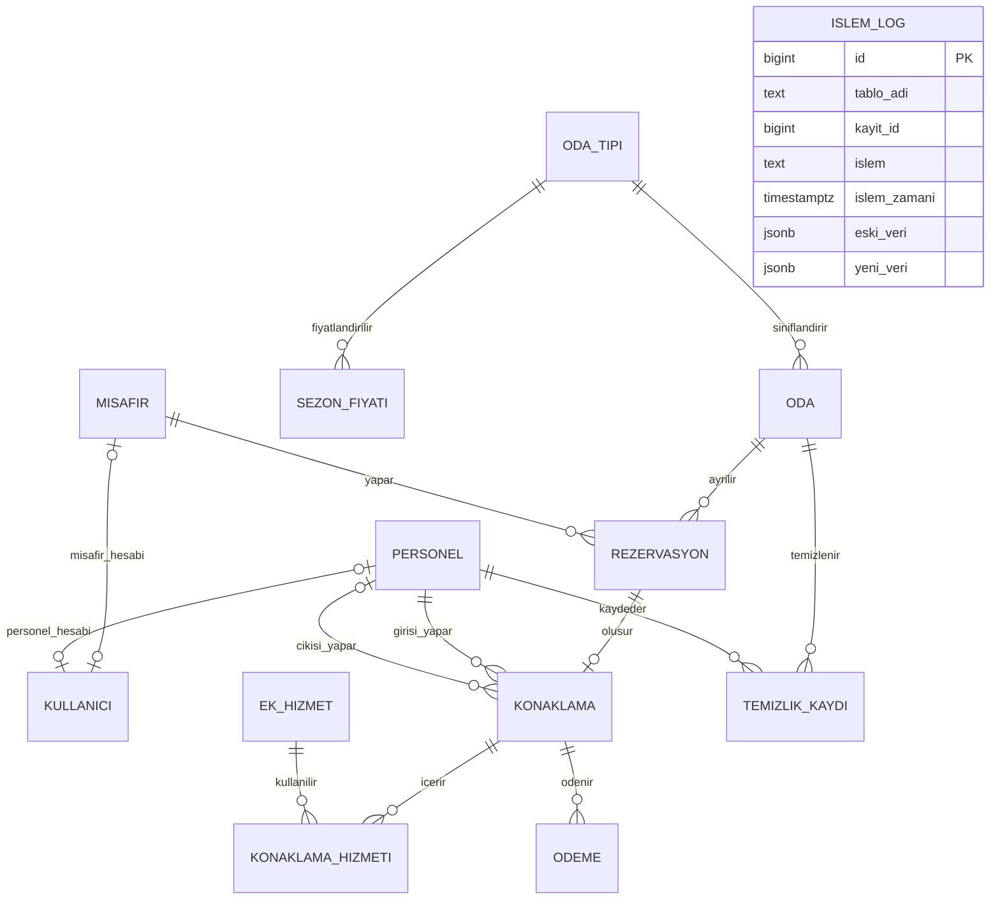

# Otel Rezervasyon ve Konaklama Yönetim Sistemi

Projenin veritabanı PostgreSQL, uygulama katmanı Spring Boot olarak planlandı.

## PostgreSQL kurulumu

DBeaver'da `otel_db` veritabanına bağlı bir SQL editörü açıp [şema ve örnek veri betiğini](database/01_sema_ve_ornek_veri.sql) boş veritabanında bir kez çalıştır. Betik 13 tabloyu, 20 odayı, 50 misafiri ve 200 rezervasyonu tek işlemde oluşturur.

Şema kurulduktan sonra aynı veritabanında [rezervasyon çakışma kuralını](database/02_rezervasyon_cakisma_kurali.sql) çalıştır. Bu betik için `btree_gist` eklentisinin PostgreSQL sunucusunda bulunması ve kurulum hesabının eklentiyi oluşturabilmesi gerekir. Çıkış tarihi aralığa dahil edilmez. İptal edilen rezervasyonlar odayı bloke etmez.

Ardından [oda durumu betiğini](database/03_konaklama_oda_durumu.sql) çalıştır. Onaylı rezervasyonla check-in yapıldığında boş oda dolu olur. Check-out yapıldığında dolu oda temizlikte durumuna geçer.

Son olarak [işlem kayıtları, prosedürler, görünümler ve indeksler betiğini](database/04_islemler_ve_raporlar.sql) çalıştır. Boş oda listesinin döndürdüğü imleci `CALL` ile aynı transaction içinde `FETCH` et. Check-out prosedürü konaklamayı kapatır, oda durumunu tetikleyici üzerinden günceller, ödemeyi kaydeder ve rezervasyonu tamamlar. Bu işlemlerden biri hata verirse çağrıdaki tüm değişiklikler geri alınır.

Oda bedeli rezervasyonun her gecesi için geçerli sezon fiyatından hesaplanır. Sezon kaydı olmayan gecelerde oda tipinin temel fiyatı kullanılır. Aylık doluluk, check-in yapılmış rezervasyonların ilgili aya düşen geceleri üzerinden hesaplanır. Gelir, ödeme tarihine göre aya yazılır.

## SQL doğrulaması ve indeks ölçümü

[İşlem testi](database/test_islemler.sql) ilk örnek veri seti üzerinde müsaitliği, sezon geçişi ve hizmet tutarını, görünümleri, işlem geçmişini, aylık raporu ve geçersiz ödeme sırasında check-out değişikliklerinin geri alındığını kontrol eder. Test kayıtları işlem sonunda geri alınır.

[İndeks ölçüm betiği](database/indeks_karsilastirma.sql), örnek rezervasyonlardan türetilen 100.000 satırlık geçici tabloda aynı tarih sorgusunu iki kez çalıştırır. PostgreSQL 14 üzerinde bir `EXPLAIN ANALYZE` çalıştırmasında alınan sonuçlar aşağıdadır. Süreler ortama ve önbelleğe göre değişebilir.

| Sorgu | Tarama | Süre |
| --- | --- | ---: |
| İndekssiz | Seq Scan | 4,623 ms |
| Tarih bileşik indeksiyle | Index Only Scan | 0,040 ms |

Oda numarası ve misafir e-postası, ilk betikteki `UNIQUE` kısıtları üzerinden indekslenir.

## ER diyagramı



Rezervasyon planlanan tarihleri, konaklama ise gerçekleşen giriş ve çıkış zamanlarını tutar. `konaklama_hizmeti`, kullanılan hizmeti adedi ve işlem anındaki birim fiyatıyla kaydeder. `islem_log`, farklı tablolardan gelen işlem geçmişini saklamak için kaynak tablo adını ve kayıt kimliğini tutar.

## Spring Boot backend

Java 21 ve Maven gerekir. PostgreSQL kurulum betiklerini çalıştırdıktan sonra proje kökünde:

```powershell
$env:OTEL_DB_PASSWORD = Read-Host 'PostgreSQL parolası' -MaskInput
mvn -f backend/pom.xml spring-boot:run
```

Varsayılan bağlantı `jdbc:postgresql://localhost:5432/otel_db`, kullanıcı ise `postgres`. Gerekirse `OTEL_DB_URL` ve `OTEL_DB_USER` ile değiştir. API yerel geliştirme için `127.0.0.1:8080` adresini dinler.

```powershell
Invoke-RestMethod 'http://127.0.0.1:8080/api/odalar/musait?giris=2027-06-01&cikis=2027-06-03&odaTipiId=1'
```

Controller isteği alır, Service tarih aralığını ve oda tipi kimliğini doğrular, Repository `bos_odalari_listele` prosedürünü çağırıp imleci aynı transaction içinde okur.
