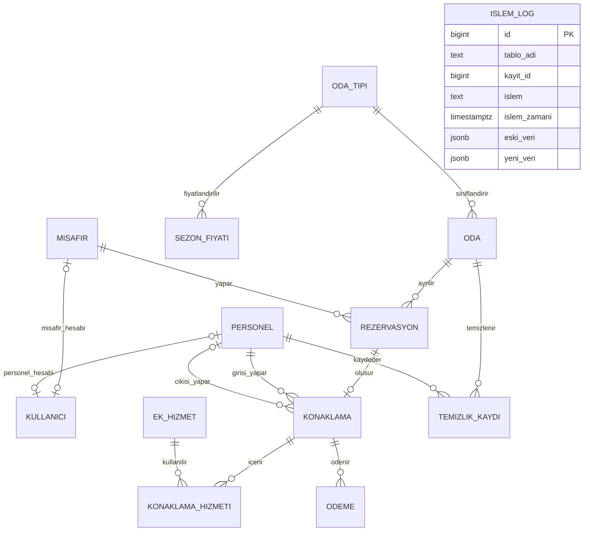

# Otel Rezervasyon ve Konaklama Yönetim Sistemi

Projenin veritabanı PostgreSQL, uygulama katmanı Spring Boot olarak planlandı.

## PostgreSQL kurulumu

DBeaver'da `otel_db` veritabanına bağlı bir SQL editörü açıp [şema ve örnek veri betiğini](database/01_sema_ve_ornek_veri.sql) boş veritabanında bir kez çalıştır. Betik 13 tabloyu, 20 odayı, 50 misafiri ve 200 rezervasyonu tek işlemde oluşturur.

Şema kurulduktan sonra aynı veritabanında [rezervasyon çakışma kuralını](database/02_rezervasyon_cakisma_kurali.sql) çalıştır. Bu betik için `btree_gist` eklentisinin PostgreSQL sunucusunda bulunması ve kurulum hesabının eklentiyi oluşturabilmesi gerekir. Çıkış tarihi aralığa dahil edilmez. İptal edilen rezervasyonlar odayı bloke etmez.

## ER diyagramı

Rezervasyon planlanan tarihleri, konaklama ise gerçekleşen giriş ve çıkış zamanlarını tutar. `konaklama_hizmeti`, kullanılan hizmeti adedi ve işlem anındaki birim fiyatıyla kaydeder. `islem_log`, farklı tablolardan gelen işlem geçmişini saklamak için kaynak tablo adını ve kayıt kimliğini tutar.
