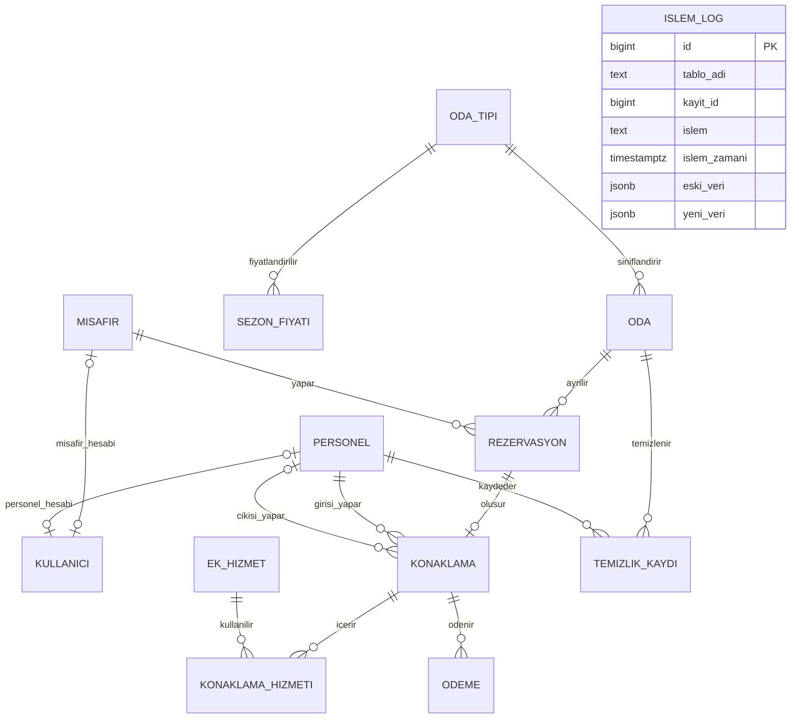

# Otel Rezervasyon ve Konaklama Yönetim Sistemi

Projenin veritabanı PostgreSQL, backend uygulaması Java 21 ve Spring Boot ile geliştiriliyor. Veritabanı erişiminde JdbcTemplate kullanılıyor.

## Mevcut durum ve mimari

- `database/` içinde şema, örnek veri, tetikleyici, prosedür, görünüm ve SQL test betikleri bulunur.
- `backend/` içinde çalışan Spring Boot API'si bulunur. Controller HTTP isteklerini karşılar, Service iş kurallarını ve transaction sınırlarını yönetir, Repository SQL sorgularını çalıştırır. `entity` paketindeki Java record'ları verileri taşır.
- Kayıt, JWT ile giriş, müsait oda arama, misafirin rezervasyon oluşturma/listeleme/iptal işlemleri ve resepsiyonun günlük liste, check-in, ek hizmet, tutar ve check-out işlemleri tamamlandı.
- Yönetici için oda tipi, oda, sezon fiyatı ve ek hizmet ekleme, listeleme, güncelleme ve silme API'leri tamamlandı. Sıradaki geliştirme personel ve hesap yönetimi. Ardından rapor API'leri, misafirin konaklama geçmişi, frontend ve teslim testleri tamamlanacak.
- Frontend geliştirildiğinde aynı deponun kökünde `frontend/` altında yer alacak.

## PostgreSQL kurulumu

DBeaver'da `otel_db` veritabanına bağlı bir SQL editörü açıp [şema ve örnek veri betiğini](database/01_sema_ve_ornek_veri.sql) boş veritabanında bir kez çalıştır. Betik 13 tabloyu, 20 odayı, 50 misafiri ve 200 rezervasyonu tek işlemde oluşturur.

Şema kurulduktan sonra aynı veritabanında [rezervasyon çakışma kuralını](database/02_rezervasyon_cakisma_kurali.sql) çalıştır. Bu betik için `btree_gist` eklentisinin PostgreSQL sunucusunda bulunması ve kurulum hesabının eklentiyi oluşturabilmesi gerekir. Çıkış tarihi aralığa dahil edilmez. İptal edilen rezervasyonlar odayı bloke etmez.

Ardından [oda durumu betiğini](database/03_konaklama_oda_durumu.sql) çalıştır. Onaylı rezervasyonla check-in yapıldığında boş oda dolu olur. Check-out yapıldığında dolu oda temizlikte durumuna geçer.

Son olarak [işlem kayıtları, prosedürler, görünümler ve indeksler betiğini](database/04_islemler_ve_raporlar.sql) çalıştır. Boş oda listesinin döndürdüğü imleci `CALL` ile aynı transaction içinde `FETCH` et. Check-out prosedürü konaklamayı kapatır, oda durumunu tetikleyici üzerinden günceller, ödemeyi kaydeder ve rezervasyonu tamamlar. Bu işlemlerden biri hata verirse çağrıdaki tüm değişiklikler geri alınır.

Oda bedeli rezervasyonun her gecesi için geçerli sezon fiyatından hesaplanır. Sezon kaydı olmayan gecelerde oda tipinin temel fiyatı kullanılır. Aylık doluluk, check-in yapılmış rezervasyonların ilgili aya düşen geceleri üzerinden hesaplanır. Gelir, ödeme tarihine göre aya yazılır.

## SQL doğrulaması ve indeks ölçümü

[İşlem testi](database/test_islemler.sql) ilk örnek veri seti üzerinde müsaitliği, sezon geçişi ve hizmet tutarını, görünümleri, işlem geçmişini, aylık raporu ve geçersiz ödeme sırasında check-out değişikliklerinin geri alındığını kontrol eder. Test kayıtları işlem sonunda geri alınır.

[İndeks ölçüm betiği](database/indeks_karsilastirma.sql), örnek rezervasyonlardan türetilen 100.000 satırlık geçici tabloda aynı tarih sorgusunu iki kez çalıştırır. PostgreSQL 14 üzerinde bir `EXPLAIN ANALYZE` çalıştırmasında alınan sonuçlar aşağıdadır. Süreler ortama ve önbelleğe göre değişebilir.

| Sorgu | Tarama | Süre |
| --- | --- | ---: |
| İndekssiz | Seq Scan | 4,623 ms |
| Tarih bileşik indeksiyle | Index Only Scan | 0,040 ms |

Oda numarası ve misafir e-postası, ilk betikteki `UNIQUE` kısıtları üzerinden indekslenir.

## ER diyagramı



Rezervasyon planlanan tarihleri, konaklama ise gerçekleşen giriş ve çıkış zamanlarını tutar. `konaklama_hizmeti`, kullanılan hizmeti adedi ve işlem anındaki birim fiyatıyla kaydeder. `islem_log`, farklı tablolardan gelen işlem geçmişini saklamak için kaynak tablo adını ve kayıt kimliğini tutar.

## Spring Boot backend

Java 21 ve Maven gerekir. PostgreSQL kurulum betiklerini çalıştırdıktan sonra IntelliJ IDEA'da aşağıdaki adımlarla uygulamayı başlat:

1. `backend/pom.xml` dosyasını Maven projesi olarak yükle ve Maven bağımlılıklarını yenile. Project SDK olarak Java 21 seç.
2. `OtelApplication.java` için bir Application çalıştırma yapılandırması oluştur.
3. **Run → Edit Configurations → Environment variables** alanında `OTEL_DB_PASSWORD` değişkenini kendi PostgreSQL parolanla tanımla.
4. **Run** ile başlat. Konsolda `Tomcat started on port 8080` yazınca Postman isteklerini gönderebilirsin. **Stop** ile uygulamayı durdur.

Parola içeren çalıştırma yapılandırmasını Git'e ekleme. Terminalden başlatmayı tercih edersen proje kökünde PowerShell 7 ile şu komutları kullan:

```powershell
$env:OTEL_DB_PASSWORD = Read-Host 'PostgreSQL parolası' -MaskInput
mvn -f backend/pom.xml spring-boot:run
```

Varsayılan bağlantı `jdbc:postgresql://localhost:5432/otel_db`, kullanıcı ise `postgres`. Gerekirse `OTEL_DB_URL` ve `OTEL_DB_USER` ile değiştir. API yerel geliştirme için `127.0.0.1:8080` adresini dinler.

```powershell
Invoke-RestMethod 'http://127.0.0.1:8080/api/odalar/musait?giris=2027-06-01&cikis=2027-06-03&odaTipiId=1'
```

Controller isteği alır, Service tarih aralığını ve oda tipi kimliğini doğrular, Repository `bos_odalari_listele` prosedürünü çağırıp imleci aynı transaction içinde okur.

### Misafir kaydı ve giriş

IntelliJ IDEA'da Maven bağımlılıklarını yenile ve `OtelApplication` çalıştırma yapılandırmasında `OTEL_DB_PASSWORD` değişkenini tanımla. Postman isteklerinde taban adres `http://127.0.0.1:8080`.

1. `POST /api/auth/kayit` için **Body → raw → JSON** seç. Başarılı kayıt `201 Created`, aynı kullanıcı adı, e-posta veya kimlik numarasıyla tekrar kayıt `409 Conflict` döndürür.

   ```json
   {
     "ad": "Deneme",
     "soyad": "Misafir",
     "kimlikNo": "TEST-0001",
     "telefon": "05550000000",
     "eposta": "deneme@example.com",
     "dogumTarihi": "2000-01-01",
     "kullaniciAdi": "deneme",
     "parola": "OrnekParola2026!"
   }
   ```

2. `POST /api/auth/giris` isteğine `{"kullaniciAdi":"deneme","parola":"OrnekParola2026!"}` gönder. Yanıttaki `token` değerini kopyala.
3. `GET /api/auth/ben` isteğinde **Authorization → Bearer Token** alanına tokenı yapıştır. Kullanıcı adı ve rol döner. Token olmadan aynı istek `401 Unauthorized` döndürür.

JWT bir saat geçerlidir. Uygulama her başlatmada yeni bir imzalama anahtarı üretir. Spring Boot'u yeniden başlatırsan tekrar giriş yap.

### Rezervasyon işlemleri

Bu isteklerde Postman'ın **Authorization → Bearer Token** alanına misafir hesabının tokenını gir. JSON gönderilen isteklerde **Body → raw → JSON** seç. Adreslerin başına `http://127.0.0.1:8080` ekle.

| Yöntem | Yol | İşlem | Başarılı yanıt |
| --- | --- | --- | --- |
| POST | `/api/rezervasyonlar` | Rezervasyon oluşturma | `201`, rezervasyon bilgileri |
| GET | `/api/rezervasyonlar` | Giriş yapan misafirin rezervasyonları | `200`, liste |
| PUT | `/api/rezervasyonlar/{id}/iptal` | Kendi rezervasyonunu iptal etme | `204`, boş yanıt |

Rezervasyon oluşturma gövdesi aşağıdaki biçimdedir. `odaId` için müsait oda aramasından dönen bir kimliği seç. Tarihleri test gününe göre düzenle.

```json
{
  "odaId": 1,
  "girisTarihi": "2027-06-01",
  "cikisTarihi": "2027-06-03",
  "kisiSayisi": 2
}
```

Giriş tarihi bugün veya gelecekte olmalı, çıkış tarihi girişten sonra olmalıdır. Oda kapasitesi kişi sayısını karşılamalıdır. Yeni rezervasyon `onayli` durumunda oluşur. Misafir kimliği JWT'deki kullanıcıdan bulunur.

Çakışan tarihler veya uygun olmayan oda/kapasite `409` döndürür. İptal adresindeki `{id}` yerine rezervasyon kimliğini yaz. Başkasına ait veya bulunamayan rezervasyon `404` döndürür. Başlamış ya da tamamlanmış konaklama iptal edilemez ve `409` döner. İptal edilmiş rezervasyon için tekrar iptal isteği `204` döndürür.

### Resepsiyon işlemleri

Bu isteklerde `resepsiyon` rolündeki hesabın tokenını kullan. Hesabın `kullanici.personel_id` alanı bir personel kaydına bağlı olmalıdır. İlk SQL betiği personel ve kullanıcı hesabı oluşturmuyor. Personel hesabı yönetimi geliştirme sırasındadır. `/api/auth/kayit` üzerinden açılan hesaplar `misafir` rolündedir. Mevcut bir resepsiyon hesabıyla `/api/auth/giris` üzerinden token alınabilir.

| Yöntem | Yol | İşlem | Başarılı yanıt |
| --- | --- | --- | --- |
| GET | `/api/resepsiyon/gunluk-giris-cikis` | PostgreSQL görünümünden bugünkü giriş ve çıkışlar | `200`, liste |
| POST | `/api/resepsiyon/rezervasyonlar/{id}/check-in` | Konaklamayı başlatma | `201`, `konaklamaId` |
| POST | `/api/resepsiyon/konaklamalar/{id}/hizmetler` | Konaklamaya ek hizmet ekleme | `201`, `konaklamaHizmetiId` |
| GET | `/api/resepsiyon/konaklamalar/{id}/tutar` | Prosedür ile toplam tutar hesaplama | `200`, `odaTutari`, `hizmetTutari`, `toplam` |
| POST | `/api/resepsiyon/konaklamalar/{id}/check-out` | Ödeme kaydı ve konaklamayı kapatma | `204`, boş yanıt |

Check-in adresindeki `{id}` rezervasyon kimliğidir. Diğer üç konaklama adresinde check-in yanıtındaki `konaklamaId` kullanılır.

Check-in isteğinin gövdesi boştur. Rezervasyon onaylı, oda boş olmalıdır. PostgreSQL'in güncel tarihi rezervasyonun giriş gününe eşit veya daha ileri, çıkış gününden önce olmalıdır. Başarılı işlemde oda tetikleyiciyle `dolu` olur. Uygun olmayan veya tekrar edilen check-in `409` döndürür.

Hizmet ekleme gövdesi aşağıdaki biçimdedir. `hizmetId`, `ek_hizmet` tablosundaki kimliktir. Adet pozitif olmalıdır. Birim fiyat hizmet kaydından okunup işlem anındaki fiyat olarak saklanır.

```json
{"hizmetId": 1, "adet": 2}
```

Check-out gövdesinde ödeme türü `nakit` veya `kart` olabilir.

```json
{"odemeTuru": "kart"}
```

Check-out prosedürü tutarı hesaplar, konaklamayı kapatır, ödemeyi kaydeder, odayı `temizlikte` ve rezervasyonu `tamamlandi` yapar. İşlemler aynı transaction içinde çalışır. Başarısızlıkta değişiklikler geri alınır. Kapalı konaklamaya hizmet ekleme veya tekrar check-out `409` döndürür.

### Yönetici için oda ve oda tipi yönetimi

Bu uç noktalarda `yonetici` rolündeki hesabın JWT'sini Postman **Authorization → Bearer Token** alanına gir. Personelle ilişkilendirilmiş yönetici hesabı gerekir. İlk kurulum betiğinde hazır yönetici hesabı bulunmaz. Hesap yönetimi sonraki geliştirme adımlarındadır.

| Yöntem | Yol | Başarılı yanıt |
| --- | --- | --- |
| GET | `/api/yonetici/oda-tipleri` | `200`, oda tipleri listesi |
| POST | `/api/yonetici/oda-tipleri` | `201`, yeni kaydın `id` değeri |
| PUT | `/api/yonetici/oda-tipleri/{id}` | `204` |
| DELETE | `/api/yonetici/oda-tipleri/{id}` | `204` |
| GET | `/api/yonetici/odalar` | `200`, odalar listesi |
| POST | `/api/yonetici/odalar` | `201`, yeni kaydın `id` değeri |
| PUT | `/api/yonetici/odalar/{id}` | `204` |
| DELETE | `/api/yonetici/odalar/{id}` | `204` |

Oda tipi ekleme ve güncelleme için JSON gövdesi:

```json
{"ad": "Aile", "kapasite": 4, "aciklama": "Aile odası", "temelFiyat": 4500.00}
```

Oda ekleme ve güncelleme için JSON gövdesi:

```json
{"numara": "501", "kat": 5, "odaTipiId": 1, "durum": "bos"}
```

`odaTipiId` alanında mevcut bir oda tipinin kimliğini kullan. PUT isteğinde tüm zorunlu alanları gönder. Kimlik URL'den alınır. Kapasite pozitif, fiyat sıfır veya pozitif ve en fazla iki ondalık basamaklı olmalıdır. Oda durumu `bos`, `dolu`, `temizlikte` veya `bakimda` olabilir.

Eksik/geçersiz alanlar `400`, uygun olmayan rol `403`, güncellenecek veya silinecek kaydın bulunamaması `404` döndürür. Aynı oda numarası/tip adı, bulunmayan oda tipine bağlantı veya ilişkili kayıtların silinmesi `409` döndürür. Rezervasyonu olan oda ve oda/sezon fiyatı tarafından kullanılan oda tipi, PostgreSQL yabancı anahtarlarıyla korunur.

Geçici PostgreSQL üzerinde her iki kaynak için oluşturma, listeleme, güncelleme ve silme doğrulandı. Misafir erişiminin reddedilmesi, yinelenen tip adı, geçersiz oda durumu, ilişkili tipin silinememesi ve bulunmayan oda için hata yanıtı kontrol edildi.

### Yönetici için sezon fiyatı yönetimi

Bu isteklerde yönetici tokenını kullan. Adreslerin başına `http://127.0.0.1:8080` ekle.

| Yöntem | Yol | Başarılı yanıt |
| --- | --- | --- |
| GET | `/api/yonetici/sezon-fiyatlari` | `200`, oda tipi ve başlangıç tarihine göre sıralı liste |
| POST | `/api/yonetici/sezon-fiyatlari` | `201`, yeni kaydın `id` değeri |
| PUT | `/api/yonetici/sezon-fiyatlari/{id}` | `204` |
| DELETE | `/api/yonetici/sezon-fiyatlari/{id}` | `204` |

POST ve PUT için **Body → raw → JSON** seç ve şu biçimde gönder. `odaTipiId` mevcut bir oda tipinin kimliği olmalıdır. PUT isteğinde tüm alanları gönder.

```json
{
  "odaTipiId": 1,
  "baslangicTarihi": "2027-06-01",
  "bitisTarihi": "2027-09-01",
  "gecelikFiyat": 2500.00
}
```

Başlangıç günü dahil, bitiş günü hariçtir. Örnekte son fiyatlandırılan gece 31 Ağustos gecesidir. Bitiş tarihi başlangıçtan sonra olmalı, fiyat sıfır veya pozitif ve en fazla iki ondalık basamaklı olmalıdır.

Aynı oda tipindeki sezonlar çakışırsa `409` döner. Önceki sezonun bittiği gün başlayan yeni sezon kabul edilir. Çakışma PostgreSQL kısıtıyla hem ekleme hem güncellemede denetlenir. Bulunmayan oda tipi `409`, geçersiz alanlar veya tarih sırası `400`, güncellenecek/silinecek sezon bulunamazsa `404` döner.

Tutar hesaplama prosedürü güncel sezon kayıtlarını okur. Sezon fiyatı değiştirilirse sonraki tutar hesaplamaları yeni fiyatı kullanır. Sezon silinirse o tarihlerde oda tipinin temel fiyatı kullanılır. Kaydedilmiş ödeme tutarı kendi ödeme kaydında saklanır.

Geçici PostgreSQL üzerinde oluşturma, listeleme, fiyat güncelleme, silme, rol kontrolü, çakışan ekleme/güncelleme, bitiş gününde başlayan sezon, negatif fiyat, ters tarihler ve bulunmayan kayıt senaryoları doğrulandı. Başarısız güncellemede eski sezon kaydının korunduğu kontrol edildi.

### Yönetici için ek hizmet yönetimi

Bu isteklerde `yonetici` rolündeki hesabın tokenını **Authorization → Bearer Token** alanına gir. Adreslerin başına `http://127.0.0.1:8080` ekle.

| Yöntem | Yol | Başarılı yanıt |
| --- | --- | --- |
| GET | `/api/yonetici/ek-hizmetler` | `200`, hizmet listesi |
| POST | `/api/yonetici/ek-hizmetler` | `201`, yeni kaydın `id` değeri |
| PUT | `/api/yonetici/ek-hizmetler/{id}` | `204` |
| DELETE | `/api/yonetici/ek-hizmetler/{id}` | `204` |

POST ve PUT için **Body → raw → JSON** seç. PUT isteğinde iki alanı da gönder.

```json
{
  "ad": "Havaalanı transferi",
  "birimFiyat": 750.00
}
```

Hizmet adı zorunlu ve en fazla 100 karakterdir. Birim fiyat sıfır veya pozitif, en fazla 10 tam sayı ve 2 ondalık basamaklı olmalıdır. Geçersiz alanlar `400`, misafir erişimi `403`, güncellenecek/silinecek hizmet bulunamazsa `404` döner. Aynı hizmet adıyla tekrar kayıt veya konaklamalarda kullanılan hizmeti silme girişimi `409` döndürür.

Fiyat güncellemesi sonraki hizmet ekleme işlemlerinde uygulanır. Daha önce `konaklama_hizmeti` tablosuna kaydedilmiş `uygulanan_birim_fiyat` korunur. Konaklamaya hizmet eklerken hizmet listesindeki kimliği resepsiyon API'sinin `hizmetId` alanında kullan.

Geçici PostgreSQL üzerinde oluşturma, listeleme, güncelleme, silme, rol kontrolü, yinelenen ad, boş ad, negatif fiyat, fazla ondalık basamak ve bulunamayan kayıt senaryoları doğrulandı. Kullanılmış hizmetin silinemediği ve fiyat değişiminden sonra geçmiş hizmet fiyatının korunduğu kontrol edildi.

### API doğrulaması

Korumalı adreslerde token eksik veya geçersizse `401`, rol uygun değilse `403` döner. Geçersiz istek alanları `400`, bulunamayan konaklama veya ek hizmet `404` döndürür.

Geliştirme sırasında geçici PostgreSQL üzerinde kayıt/giriş, tekrar kayıt sırasında rollback, JWT kontrolü, rezervasyon çakışması ve sahipliği, resepsiyon rolü, check-in, ek hizmetin tutara dahil edilmesi, check-out sonrası ödeme ve oda durumu test edildi. Tekrar check-out'un ikinci ödeme oluşturmadığı ve kapalı konaklamaya hizmet eklenemediği doğrulandı.

Bu HTTP kontrolleri PowerShell istekleriyle çalıştırıldı. Teslim edilecek Postman/Swagger koleksiyonu ve test videosu geliştirme planında bulunuyor.
